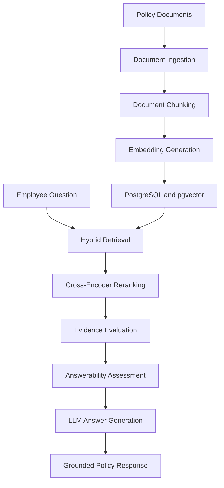

# Office Loan Policy Assistant

**An AI-powered assistant for organizational loan policy guidance, loan calculations, and employee loan assessments.**


---

## 1. Project Overview

The **Office Loan Policy Assistant** is an AI-powered application developed to help employees:

- Understand organizational loan policies.
- Calculate potential loan repayments.
- Calculate illustrative loan interest.
- Assess their eligibility for available loan facilities.
- Ask natural-language questions about organizational loan policies.

The application combines conventional backend engineering with **Retrieval-Augmented Generation (RAG)**. This enables employees to ask questions about organizational loan policies and receive responses grounded in retrieved policy documents.

The solution includes:

- A React and TypeScript frontend.
- A FastAPI backend.
- A PostgreSQL database with pgvector.
- LLM integration through Microsoft Foundry.
- Docker-based containerization.
- Deployment on Microsoft Azure.
- Application security, monitoring, and observability controls.

---

## 2. Key Features

The Office Loan Policy Assistant currently supports:

- Employee authentication using JSON Web Tokens (JWT).
- Secure password hashing using Argon2.
- Authenticated employee profile retrieval.
- Loan repayment calculations.
- Illustrative loan interest calculations.
- Authenticated employee loan assessments.
- AI-powered organizational policy assistance.
- Policy document ingestion and chunking.
- Vector embedding generation.
- Semantic retrieval.
- Hybrid search.
- Cross-encoder reranking.
- Evidence evaluation.
- Answerability assessment.
- API rate limiting.
- Centralized application logging.
- Cloud monitoring and observability.

---

## 3. Technology Stack

| Component | Technology |
|---|---|
| Programming Language | Python 3.14 |
| Backend | FastAPI |
| Frontend | React 19 and TypeScript |
| Frontend Build Tool | Vite |
| Database | PostgreSQL |
| Vector Extension | pgvector |
| ORM | SQLAlchemy |
| Database Migrations | Alembic |
| AI Integration | Microsoft Foundry |
| LLM Client | OpenAI SDK |
| Embeddings | Sentence Transformers |
| Retrieval | Hybrid Search |
| Reranking | Cross-Encoder |
| Authentication | JWT and Argon2 |
| Rate Limiting | SlowAPI |
| Package Management | uv |
| Containerization | Docker and Docker Compose |
| Cloud Platform | Microsoft Azure |
| Monitoring | Azure Monitor, Application Insights, and OpenTelemetry |
| Testing | Pytest |

---

## 4. System Architecture

The application is organized into the following layers:

1. **Presentation Layer** 
   A React and TypeScript frontend that provides the employee-facing interface.

2. **API Layer** 
   FastAPI endpoints for authentication, employee profiles, loans, and organizational policy questions.

3. **Business Logic Layer** 
   Services responsible for authentication, loan calculations, loan assessments, and eligibility processing.

4. **AI and RAG Layer** 
   Services responsible for document ingestion, chunking, embedding, retrieval, reranking, evidence evaluation, answerability assessment, and LLM generation.

5. **Data Layer** 
   PostgreSQL stores relational application data, while pgvector stores and searches document embeddings.

6. **Infrastructure Layer** 
   Docker and Microsoft Azure services support containerization, deployment, configuration, secret management, and monitoring.

### RAG Workflow



The RAG workflow follows this sequence:

```text
Policy Documents
       |
       v
Document Ingestion
       |
       v
Document Chunking
       |
       v
Embedding Generation
       |
       v
PostgreSQL + pgvector
       |
       v
Hybrid Retrieval
       |
       v
Cross-Encoder Reranking
       |
       v
Evidence Evaluation
       |
       v
Answerability Assessment
       |
       v
LLM Answer Generation
       |
       v
Grounded Policy Response
```

### Repository Structure

```text
office-loan-policy-assistant/
├── alembic/ # Database migrations
├── docs/
│ ├── architecture.md # System architecture documentation
│ ├── deployment.md # Azure deployment documentation
│ ├── monitoring.md # Monitoring documentation
│ └── benchmark-submission.md # Benchmark submission
├── frontend/ # React and TypeScript application
├── src/
│ └── office_loan_policy_assistant/
│ ├── api/ # FastAPI routers
│ ├── core/ # Configuration and security
│ ├── db/ # Database connectivity
│ ├── models/ # Database models
│ ├── schemas/ # API schemas
│ ├── scripts/ # Ingestion and evaluation scripts
│ ├── services/ # Business logic and RAG services
│ └── main.py # Application entry point
├── tests/ # Automated tests
├── Dockerfile
├── compose.yaml
├── pyproject.toml
└── uv.lock
```

---

## 5. API Reference

The backend exposes the following principal endpoints:

| Method | Endpoint | Description | Authentication |
|---|---|---|---|
| `POST` | `/auth/login` | Authenticate an employee | No |
| `GET` | `/employees/me` | Retrieve the authenticated employee's profile | Yes |
| `POST` | `/loans/calculate` | Calculate a hypothetical loan | No |
| `POST` | `/loans/interest` | Calculate illustrative loan interest | No |
| `POST` | `/loans/my-assessment` | Assess a loan using authenticated employee details | Yes |
| `POST` | `/policy/ask` | Ask questions about organizational loan policies | See API security configuration |

Interactive API documentation is available when the backend is running:

```text
http://localhost:8000/docs
```

---

## 6. Local Development Setup

### Prerequisites

Before running the application locally, ensure the following tools are installed:

- Python 3.14
- uv
- Node.js
- npm
- Docker
- Docker Compose
- Git

### 6.1 Clone the Repository

```bash
git clone https://github.com/mfaniyi/office-loan-policy-assistant.git
cd office-loan-policy-assistant
```

### 6.2 Configure Environment Variables

Create a `.env` file in the project root:

```env
POSTGRES_USER=your_database_user
POSTGRES_PASSWORD=your_database_password
POSTGRES_DB=office_loan_policy_db
POSTGRES_HOST=localhost
POSTGRES_PORT=5433
POSTGRES_SSLMODE=prefer

JWT_SECRET_KEY=replace_with_a_strong_secret
JWT_ALGORITHM=HS256
ACCESS_TOKEN_EXPIRE_MINUTES=30
```

Add any additional environment variables required by the configured LLM service.

> [!WARNING]
> Never commit real credentials, passwords, API keys, access tokens, secrets, or connection strings to source control.

Ensure that `.env` is included in the project's `.gitignore` file.

### 6.3 Install Backend Dependencies

Install the Python dependencies using `uv`:

```bash
uv sync
```

### 6.4 Start PostgreSQL

Start the local PostgreSQL service:

```bash
docker compose up -d db
```

Verify that the database service is running:

```bash
docker compose ps
```

The local PostgreSQL service uses a PostgreSQL 17 image with pgvector and exposes port `5433`.

### 6.5 Apply Database Migrations

Apply all available Alembic migrations:

```bash
uv run alembic upgrade head
```

Check the current migration version:

```bash
uv run alembic current
```

### 6.6 Start the Backend

Start the FastAPI development server:

```bash
uv run fastapi dev src/office_loan_policy_assistant/main.py
```

The backend will be available at:

```text
http://localhost:8000
```

Interactive API documentation will be available at:

```text
http://localhost:8000/docs
```

### 6.7 Start the Frontend

Open another terminal and navigate to the frontend directory:

```bash
cd frontend
```

Install the frontend dependencies:

```bash
npm ci
```

Configure the frontend API base URL using the environment variable expected by the frontend API service.

Start the Vite development server:

```bash
npm run dev
```

The frontend development server will be available at:

```text
http://localhost:5173
```

---

## 7. Database and Policy Ingestion

The application uses PostgreSQL for relational data and pgvector for policy-document embeddings.

Database schema changes are managed through Alembic migrations.

The project includes scripts for:

- Seeding employee records.
- Ingesting organizational policy documents.
- Extracting and chunking policy text.
- Generating document embeddings.
- Storing embeddings in PostgreSQL.
- Evaluating retrieval performance.

Review the available scripts under:

```text
src/office_loan_policy_assistant/scripts/
```

Configure all required database and LLM settings before running the ingestion or evaluation scripts.

---

## 8. Testing

The project uses Pytest for automated testing.

Run the complete test suite:

```bash
uv run pytest
```

Run the test suite with concise output:

```bash
uv run pytest -q
```

Test coverage includes:

- Authentication.
- Database configuration.
- Employee eligibility.
- Loan API operations.
- Loan services.
- Application startup.
- Personal loan functionality.
- RAG functionality.
- Security.

Previously recorded test result:

```text
87 passed, 10 warnings
```

> [!NOTE]
> This represents a previously recorded test run. Run the test suite locally or through CI to verify the current project state.

---

## 9. Docker

The project includes separate Dockerfiles for the backend and frontend.

### Backend Container

The backend uses a multi-stage Python build with `uv`.

### Frontend Container

The frontend uses:

- A multi-stage Node.js build.
- A production build generated by Vite.
- Nginx for production delivery.

### Local Container Orchestration

Build and start the configured services:

```bash
docker compose up --build
```

Start the services in detached mode:

```bash
docker compose up --build -d
```

Check the running containers:

```bash
docker compose ps
```

Stop the containers:

```bash
docker compose down
```

Stop the containers and remove their persistent volumes:

```bash
docker compose down -v
```

The Docker Compose configuration defines the PostgreSQL and backend API services.

---

## 10. Azure Deployment

The application is deployed using the following Microsoft Azure services:

- **Azure Container Registry** for storing container images.
- **Azure Container Apps** for hosting the frontend and backend.
- **Azure Database for PostgreSQL Flexible Server** for managed relational and vector data.
- **Azure Key Vault** for secret management.
- **Azure Managed Identity** for secure access to Azure resources.
- **Azure Application Insights** for application telemetry.
- **Azure Monitor** for application monitoring and operational analysis.

The frontend and backend are hosted as separate Azure Container Apps.

See the [Azure Deployment Guide](docs/deployment.md) for infrastructure details, deployment configuration, and validation procedures.

---

## 11. Security

The application includes the following security controls:

- JWT-based authentication.
- Argon2 password hashing.
- API rate limiting.
- CORS restrictions.
- Environment-based configuration.
- Azure Key Vault secret management.
- Azure Managed Identity for Azure resource access.
- TLS-secured Azure PostgreSQL connectivity.

### Security Guidelines

Never commit any of the following to source control:

- `.env` files.
- Passwords.
- JWT signing secrets.
- API keys.
- Access tokens.
- Database connection strings.
- Cloud credentials.
- Service credentials.

Use environment variables, Azure Key Vault, and Managed Identity wherever applicable.

---

## 12. Monitoring and Observability

Azure Monitor OpenTelemetry integrates the backend with Application Insights.

The shared Azure Monitor Workbook contains six monitoring panels:

1. **API Request Volume**
2. **Successful vs Failed Requests**
3. **Average and P95 API Latency**
4. **Dependency Performance**
5. **Application Logs by Severity**
6. **Application Exceptions**

The initial monitoring validation confirmed that the following telemetry was being received:

- Request telemetry.
- Dependency telemetry.
- Application logs.

> [!IMPORTANT]
> The initial request sample is limited and should not be interpreted as a formal application performance benchmark.

See the [Monitoring Documentation](docs/monitoring.md) for implementation and validation details.

---

## 13. Documentation

Additional project documentation is available in the `docs` directory:

| Document | Description |
|---|---|
| [System Architecture](docs/architecture.md) | Describes the application layers, components, and RAG workflow |
| [Azure Deployment](docs/deployment.md) | Documents the cloud infrastructure and deployment configuration |
| [Monitoring](docs/monitoring.md) | Explains the Application Insights, Azure Monitor, and OpenTelemetry implementation |
| [Benchmark Submission](docs/benchmark-submission.md) | Summarizes the project objectives, implementation, evidence, risks, and future improvements |

---

## 14. Limitations and Future Improvements

Potential improvements include:

1. Expanding the RAG evaluation dataset.
2. Measuring retrieval precision, recall, and ranking quality.
3. Evaluating answer faithfulness and groundedness.
4. Performing representative load and stress testing.
5. Verifying database dependency telemetry.
6. Conducting controlled exception-capture testing.
7. Improving operational alerting.
8. Introducing CI/CD automation.
9. Expanding application audit logging.

---

## 15. Author

**Michael O. Faniyi**

AI/ML Engineering | Data Analytics | Microsoft Azure | Power BI

- **GitHub:** [mfaniyi](https://github.com/mfaniyi)
- **Project:** Office Loan Policy Assistant
- **Project Type:** AI/ML Engineering Capstone
- **Version:** `1.0.0`